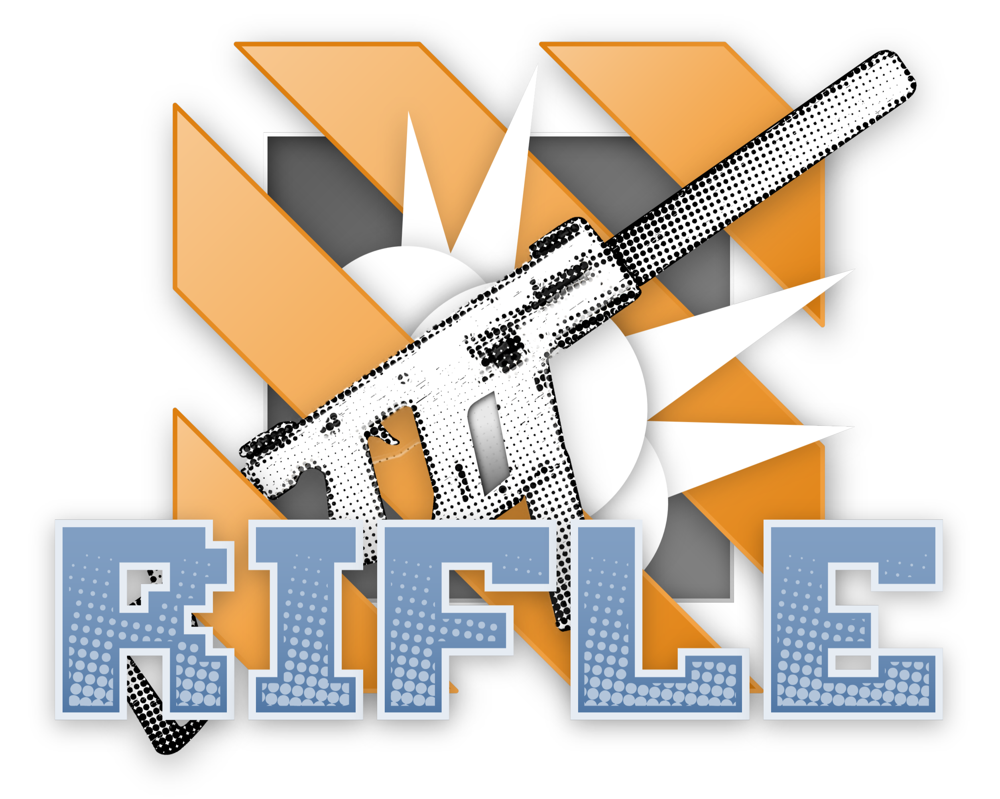
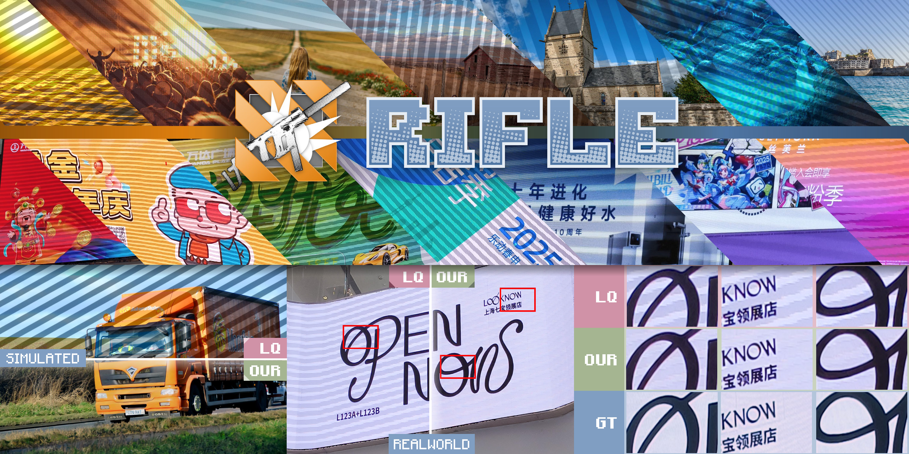
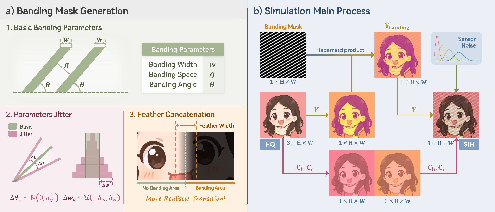
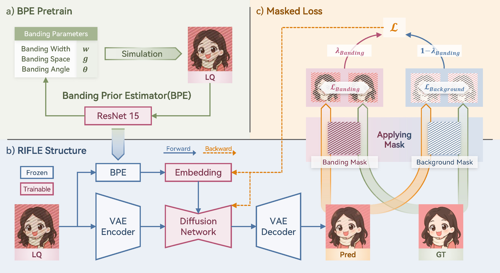
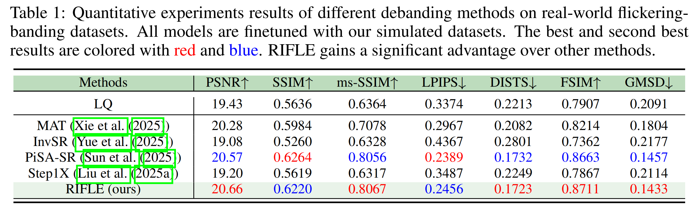
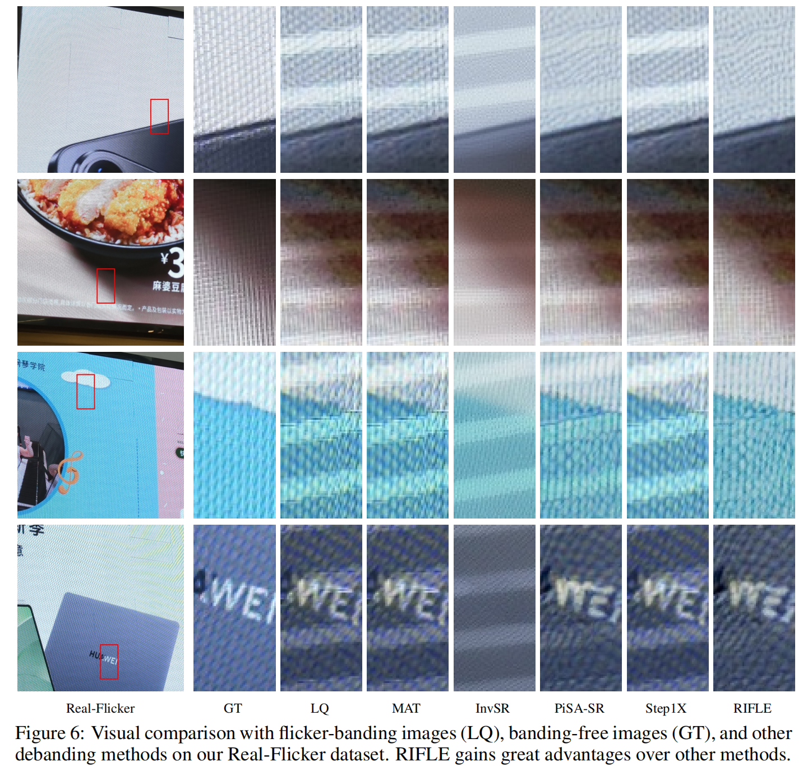

<div align="center">
  <p align="center">
    
  </p>
</div>

# RIFLE: Removal of Image Flicker-Banding via Latent Diffusion Enhancement

[LiBo Zhu](https://github.com/LiBoZhu030073), [Zihan Zhou](https://github.com/ZZH-qwq), [Xiaoyang Liu](), [Weihang Zhang](), [Keyu Shi](), [Yifan Fu]() and [Yulun Zhang](http://yulunzhang.com/)
**"RIFLE: Removal of Image Flicker-Banding via Latent Diffusion Enhancement", arxiv 2025**

[](https://libozhu03.github.io/RIFLE/)
[](https://arxiv.org/abs/2509.24644)
[](https://github.com/libozhu03/RIFLE/releases/download/preprint_v1/supp.pdf)
[](https://github.com/libozhu03/RIFLE)

<!-- [](https://github.com/libozhu03/RIFLE/releases) -->

<!-- [](https://github.com/libozhu03/RIFLE) -->

<p align="center">
   
</p>

---

## 📚 Table of Contents

- [🔥 News](#-news)
- [📘 Abstract](#-abstract)
- [📝 Structure Overview](#-structure-overview)
- [⚙️ Installation](#️-installation)
- [📥 Download Pretrained Models and Datasets](#-download-pretrained-models-and-datasets)
- [🧪 Inference](#-inference)
- [Training](#training)
- [Simulation](#simulation)
- [Repository layout](#repository-layout)
- [🔎 Results](#-results)
- [📝 Acknowledgements](#-acknowledgements)
- [📌 Citation](#-citation)

---

## 🔥 News

- **[2026-11-12]** The [real-world RIFLE evaluation dataset](https://huggingface.co/datasets/Laborrrrrrrr/RIFLE) is now public, with 4K image pairs and 512 × 512 test crops.
- **[2026-10-16]** Code is released.
- 🏆 **[2026-09-25]** Congratulations! RIFLE has been accepted to NeurIPS 2026.
- **[2025-09-29]** Create repository.

### ⭐⭐⭐ If RIFLE is helpful to your projects, please help star this repo. Thanks!

## 📘 Abstract

> Capturing screens is now routine in our everyday lives. But the photographs of emissive displays are often influenced by the flicker-banding (FB), which is alternating bright–dark stripes that arise from temporal aliasing between a camera’s rolling-shutter readout and the display’s brightness modulation. Unlike moiré degradation, which has been extensively studied, the FB remains underexplored despite its frequent and severe impact on readability and perceived quality. We formulate FB removal as a dedicated restoration task and introduce Removal of Image Flicker-Banding via Latent Diffusion Enhancement, RIFLE, a diffusion-based framework designed to remove FB while preserving fine details. We propose the flicker-banding prior estimator (FPE) that predicts key banding attributes and injects it into the restoration network. Additionally, Masked Loss (ML) is proposed to concentrate supervision on banded regions without sacrificing global fidelity. To overcome data scarcity, we provide a simulation pipeline that synthesizes FB in the luminance domain with stochastic jitter in banding angle, banding spacing, and banding width. Feathered boundaries and sensor noise are also applied for a more realistic simulation. For evaluation, we collect a paired real-world FB dataset with pixel-aligned banding-free references captured via long exposure. Across quantitative metrics and visual comparisons on our real-world dataset, RIFLE consistently outperforms recent image reconstruction baselines from mild to severe flicker-banding. To the best of our knowledge, it is the first work to research the simulation and removal of FB. Our work establishes a great foundation for subsequent research in both the dataset construction and the removal model design.

## 📝 Structure Overview

<p align="center">
   <br>
    <em>Figure 1. Simulation process of flicker-banding</em>
</p>

<p align="center">
   <br>
    <em>Figure 2. Overview of our flicker-banding removing model</em>
</p>

<div align="center">

 


</div>

## ⚙️ Installation

Use Python 3.11 and a matching PyTorch / torchvision installation for your machine.
The reference environment uses PyTorch 2.2.2 and torchvision 0.17.2; choose matching
CUDA wheels when running on Linux.

```bash
python3.11 -m venv .venv
source .venv/bin/activate
python -m pip install torch==2.2.2 torchvision==0.17.2
python -m pip install -r requirements.txt
```

The release uses one RIFLE implementation: a single-channel GP banding prior,
FiLM injection and masked supervision. Diffusers / PEFT versions are pinned.
xformers is optional and disabled by default.

## Repository layout

```text
RIFLE/
├── train.py          # training and resume
├── infer.py          # image / screen-region restoration
├── simulate.py       # paired flicker-banding data generation
├── rifle/            # model, data, prior, simulator and VAE tiling
├── configs/          # one training recipe and two simulation profiles
├── scripts/          # short command wrappers
├── tests/            # numerical and workflow regression checks
├── assets/           # paper figures
├── docs/             # reproduction notes
└── weights/          # checkpoint instructions and checksum
```

## 📥 Download Pretrained Models and Datasets

| Model | Download | Extraction code | Local path |
| --- | --- | --- | --- |
| Stable Diffusion 2.1 base (`sd21.zip`) | [Baidu Netdisk](https://pan.baidu.com/s/15GuxzqXme4yycgWdqsen8g?pwd=ca6v) | `ca6v` | `preset/models/sd21/` |
| RIFLE checkpoint (`RIFLE.pkl`) | [Baidu Netdisk](https://pan.baidu.com/s/1EIUj_0phH5XWK6w8_7xAhw?pwd=w99g) | `w99g` | `weights/RIFLE.pkl` |

Download both assets. Extract `sd21.zip` and place the SD2.1 model directory at
`preset/models/sd21/`,
with `tokenizer/`, `text_encoder/`, `scheduler/`, `unet/` and `vae/` directly inside.
Place `RIFLE.pkl` in `weights/`. To use a different SD2.1 location:

```bash
export PRETRAINED_MODEL_PATH=/path/to/sd21
```

See [checkpoint instructions](weights/README.md) for the SHA256 checksum and
[data preparation](docs/REPRODUCING.md#data-layout) for the dataset layout.

### Dataset

The [RIFLE evaluation dataset on Hugging Face](https://huggingface.co/datasets/Laborrrrrrrr/RIFLE) contains paired photographs for evaluating flicker-banding removal. Each image in `lq/` shows flicker-banding. Its counterpart in `gt/` has the same filename and provides the banding-free reference.

| Folder | Contents | Image pairs | Resolution |
| --- | --- | ---: | --- |
| `4K/` | Full-resolution photographs (JPEG) | 107 | 4096 × 2304 or 4096 × 3072 |
| `test_512/` | Test crops (PNG) | 424 | 512 × 512 |

Download the dataset (1.21 GB) from the project root using the [Hugging Face CLI](https://huggingface.co/docs/huggingface_hub/guides/cli).

```bash
hf download Laborrrrrrrr/RIFLE --repo-type dataset --local-dir data/RIFLE
```

After installing the pretrained models, run inference on the test crops.

```bash
python infer.py --pretrained_path weights/RIFLE.pkl --input_path data/RIFLE/test_512/lq --output_dir results/rifle_test_512
```

Use `data/RIFLE/test_512/gt/` as the reference directory when evaluating the restored crops.

## 🧪 Inference

### Without a screen mask

Restore the entire image. `--input_path` accepts an image or a folder:

```bash
python infer.py \
  --pretrained_path weights/RIFLE.pkl \
  --input_path /path/to/images \
  --output_dir results/restored
```

### With a screen mask

Restore only the screen region while preserving pixels outside the mask:

```bash
python infer.py \
  --pretrained_path weights/RIFLE.pkl \
  --input_path /path/to/images \
  --mask_dir /path/to/masks \
  --output_dir results/restored_masked
```

Inputs and masks must share filename stems and be spatially aligned. Use binary
masks with white (255) for the screen region and black (0) for the background.
The screen-mask shell wrapper provides the same mode:


## Training

Edit the clean-image folders in [configs/data.yaml](configs/data.yaml) and the
validation folders in [configs/train.yaml](configs/train.yaml), then train:

```bash
python train.py --config configs/train.yaml
```

See [reproduction notes](docs/REPRODUCING.md) for resume, data preparation and
checkpoint compatibility. [Third-party notices](THIRD_PARTY.md)
record the retained attribution and pending license decisions.

## Simulation

The original Y-band simulator is included in `rifle/simulation.py`. Generate
paired images independently with:

```bash
python simulate.py \
  --gt_dirs /path/to/clean_images \
  --out_dir results/synthetic \
  --config configs/simulation/screenfocus.yaml \
  --num 100 --seed 0
```

The simulator writes clean references to `reference/`, degraded images to
`banding/`, banding masks to `banding_mask/` and metadata to `index.json` under
`--out_dir`. The simulation profile can also be changed to
`configs/simulation/screenmix.yaml`.

## <a name="-results"></a> 🔎 Results
RIFLE significantly out-performs previous methods, which are fintuned with our simulated datasets.


<details>
<summary> 📊 Quantitative comparisons in Table 1 of the main paper (click to expand)</summary>

<p align="center">
  
</p>
</details>

<details>
<summary> 🖼 Visual comparison in Figure 6 of the main paper (click to expand)
</summary>

<p align="center">
  
</p>
</details>


## 📝 Acknowledgements
We would like to thank the developers and maintainers of [Stable Diffusion](https://github.com/Stability-AI/StableDiffusion), [Diffusers](https://github.com/huggingface/diffusers), and [PiSA-SR](https://github.com/csslc/PiSA-SR) for their open-source contributions, which have greatly facilitated our research and development.

This project is supported in part by the Shanghai Jiao Tong University Artificial Intelligence Institute.

We also thank our collaborators and contributors for their valuable feedback and technical discussions.

## 📌 Citation

```bibtex
@inproceedings{zhu2026rifle,
  title={{RIFLE}: Removal of Image Flicker-Banding via Latent Diffusion Enhancement},
  author={Libo, Zhu and Zihan, Zhou and Xiaoyang, Liu and Weihang, Zhang and Keyu, Shi and Yifan, Fu and Yulun, Zhang},
  booktitle={NeurIPS},
  year={2026}
}
```
